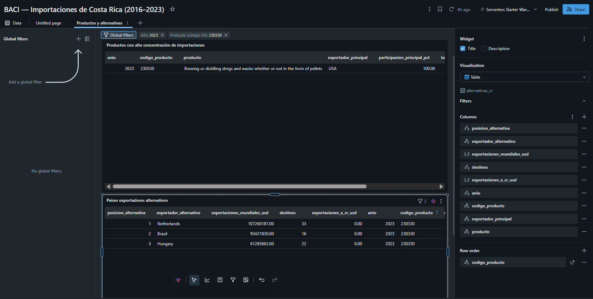

# BACI: concentración de importaciones de Costa Rica

Pipeline batch con PySpark, Databricks, Delta y Lakeflow Jobs. Procesa comercio bilateral mundial de BACI HS92, edición **202501**, para **2016–2023**. Identifica productos que Costa Rica importa con alta concentración en un país y encuentra otros países que exportaban esos mismos productos al mundo.

El Job configurado en la interfaz terminó con estado **Succeeded** el **18 de noviembre de 2026**, con una duración observada de **8 min 29 s**. Ese mismo día también se validó, desplegó y ejecutó la configuración portátil mediante **Databricks CLI v1.26.0**: el Job del destino `dev` terminó con estado **`TERMINATED SUCCESS`**. Las pruebas se realizaron en el workspace del proyecto, con los datos de origen ya disponibles; véase [el registro de validación](docs/VALIDACION.md).

La configuración actual separa las tablas de desarrollo (`workspace.baci_dev`) de las que consulta el dashboard (`workspace.baci`). Las ejecuciones históricas anteriores a este cambio usaban el mismo esquema. La comprobación de esta separación en Databricks se describe en [Entornos](docs/ENTORNOS.md).

## Archivos del proyecto

| Archivo | Función |
|---|---|
| `databricks.yml` | Define el bundle, el destino `dev` y la carpeta de despliegue del usuario autenticado. |
| `resources/baci_cr_pipeline.job.yml` | Define las cuatro tareas del Job, sus dependencias y su configuración. |
| `baci_cr/00_configuracion.py` | Contiene período, edición, rutas y filtros analíticos compartidos. |
| `baci_cr/01_archivos_raw.py` | Extrae del ZIP los archivos seleccionados o reutiliza las copias existentes. |
| `baci_cr/02_comercio_enriquecido.py` | Lee los CSV, valida los catálogos, realiza las uniones y guarda el comercio global. |
| `baci_cr/03_indicadores_cr.py` | Calcula la concentración de importaciones de CR y los países alternativos. |
| `baci_cr/04_validaciones.py` | Comprueba cobertura y coherencia de las tablas analíticas. |
| `baci_cr/05_consultas_cr.py` | Consulta el resumen anual, productos seleccionados, evolución y alternativas. |
| `baci_cr/catalogos.py` | Función compartida para reparar los nombres de países. |
| `baci_cr/transformaciones.py` | Funciones PySpark de enriquecimiento, concentración y alternativas. |
| `tests/` | Pruebas de las funciones con ejemplos pequeños y resultados conocidos. |
| `.github/workflows/tests.yml` | Ejecuta las pruebas automáticamente en GitHub Actions. |
| `docs/PRUEBAS.md` | Explica la cobertura de las pruebas, CI y la comprobación en Databricks. |
| `docs/ENTORNOS.md` | Explica la separación de tablas, los insumos compartidos y cómo verificarla. |
| `docs/VALIDACION.md` | Registra las evidencias observadas y el alcance de la revisión local. |

Los archivos numerados `00`–`05` conservan el formato de notebook fuente de Databricks. El procesamiento de los datos BACI se ejecuta en Databricks; no se ejecutan estos notebooks con `python archivo.py` en la computadora personal. `catalogos.py` y `transformaciones.py` son módulos Python normales que deben mantenerse junto a los notebooks y desplegarse con el bundle.

## Pruebas automáticas

La suite incluye 59 casos: 30 para nombres y transformaciones PySpark, y 29 para la configuración de entornos, el destino de las escrituras y la lectura de insumos en desarrollo. Los notebooks `02` y `03` importan las mismas funciones que verifican las pruebas.

El workflow **Pruebas BACI** se ejecuta en cada `push` y `pull_request`, y también puede iniciarse manualmente desde GitHub Actions. Usa Python 3.12, Java 21, pytest 8.4.2 y PySpark 4.0.1 con datos sintéticos; no necesita credenciales ni cómputo de Databricks. El resultado esperado es `59 passed`.

Las pruebas complementan a `04_validaciones`, que revisa las tablas reales. La integración completa se comprueba al desplegar y ejecutar el Job en Databricks. [Consultar las instrucciones de pruebas](docs/PRUEBAS.md).

## Orden de ejecución

| Tarea | Depende de | Resultado |
|---|---|---|
| `01_archivos_raw` | — | Ocho CSV de comercio, dos catálogos y `Readme.txt`. |
| `02_comercio_enriquecido` | `01_archivos_raw` | Tabla global `comercio_enriquecido`. |
| `03_indicadores_cr` | `02_comercio_enriquecido` | Tablas `concentracion_importaciones_cr` y `alternativas_importaciones_cr`. |
| `04_validaciones` | `03_indicadores_cr` | Controles y resumen de cobertura. |

Las tareas posteriores usan `ALL_SUCCESS`. Cada notebook lee el parámetro `entorno` y después carga `00_configuracion` con `%run ./00_configuracion`; por eso los seis notebooks se mantienen juntos. `05_consultas_cr` se usa para explorar los resultados y no es una tarea del Job. Sin un parámetro explícito se utiliza `dev`.

## Datos y preparación del workspace

El paquete contiene código y documentación. El insumo necesario es **`BACI_HS92_V202501.zip`**, que debe obtenerse de CEPII o de la copia de esa edición conservada para el proyecto. El archivo de datos no está incluido en este paquete.

Con la configuración actual, deben existir:

| Recurso | Nombre o ruta |
|---|---|
| Catálogo | `workspace` |
| Esquema | `workspace.baci` |
| Volumen | `workspace.baci.raw` |
| ZIP de origen | `/Volumes/workspace/baci/raw/BACI_HS92_V202501.zip` |

En un workspace nuevo, prepará esos recursos y subí el ZIP al volumen. Para extraer los insumos por primera vez, ejecutá únicamente `01_archivos_raw` con el widget `entorno=prod`; después utilizá `dev` para las pruebas. La etapa 01 en desarrollo verifica los archivos ya extraídos y falla si faltan o su tamaño no coincide, sin modificarlos.

La identidad de desarrollo necesita lectura del volumen y permisos para crear y reemplazar tablas en `workspace.baci_dev`. Si ese esquema todavía no existe, necesita crearlo en el catálogo; alternativamente, su propietario puede crearlo antes. La extracción inicial requiere escritura en el volumen. `CATALOGO` configura las salidas; `CATALOGO_RAW`, `ESQUEMA_RAW` y `VOLUMEN` configuran los insumos de forma independiente.

La etapa 01 extrae únicamente los años configurados y los catálogos. Reutiliza un archivo cuando su tamaño coincide con el registrado en el ZIP; esa comparación no comprueba igualdad criptográfica. El ZIP sigue siendo necesario aunque los CSV estén extraídos.

## Resultados observados con los parámetros actuales

| Medida | Resultado |
|---|---:|
| Filas de comercio mundial | 86.758.220 |
| Combinaciones de producto y año para CR | 33.727 |
| Productos distintos importados por CR en el período | 4.524 |
| Años | 8, de 2016 a 2023 |
| Casos seleccionados de producto y año | 957 |
| Filas de países candidatos | 2.871 |
| Casos seleccionados sin candidatos | 0 |

Estos valores proceden de las salidas compartidas por el usuario. Los 957 casos incluyen productos repetidos en distintos años. Cambiar edición, período, filtros o archivos puede cambiar los conteos.

## Tablas y criterios

Las tres salidas son tablas Delta bajo `workspace.baci_dev` al usar `entorno=dev`, o `workspace.baci` al elegir explícitamente `entorno=prod`. El dashboard sigue consultando `workspace.baci`:

| Tabla | Unidad de una fila |
|---|---|
| `comercio_enriquecido` | Flujo de un exportador a un importador, para un producto y año. |
| `concentracion_importaciones_cr` | Un producto importado por Costa Rica en un año y edición. |
| `alternativas_importaciones_cr` | Un país candidato para un producto, año y edición seleccionados. |

El valor original `v` está expresado en miles de USD; `valor_usd = v × 1000`. La participación principal es el valor importado desde el país principal dividido entre el valor total importado de ese producto y año, multiplicado por 100.

Los parámetros actuales seleccionan productos con importaciones de CR **≥US$1 millón por año** y participación del exportador principal **≥90 %**. Para cada caso se conservan hasta tres países alternativos, ordenados por valor exportado mundial; el número de destinos y el código del país resuelven empates. Se excluyen Costa Rica y el exportador principal.

Los filtros son decisiones exploratorias del proyecto. Los países candidatos representan exportaciones históricas; pueden incluir reexportaciones y no acreditan oferta disponible, viabilidad logística ni empresas proveedoras. Un cero hacia CR indica ausencia de un flujo registrado en ese recorte de BACI. Los montos son nominales.

En la tabla de alternativas se repite el total importado por CR por cada candidato. Para sumar importaciones anuales se utiliza la tabla de concentración.

El catálogo de productos incluye `9999AA`, descrito por la fuente como código legado no WCO. La etapa 02 admite esa excepción en el catálogo y conserva el texto exacto. Los códigos numéricos se completan a seis dígitos antes de unir las tablas; los códigos de comercio del período probado superaron su validación numérica.

## Ejecutar el Job que ya existe

En Databricks, abrí `Jobs & Pipelines`, seleccioná `baci_cr_pipeline` y usá `Run now`. Se configuró para ejecución manual. Al finalizar, revisá el estado de la ejecución y la salida de `04_validaciones`.

El Job original creado en la interfaz y el Job del bundle son recursos distintos. El despliegue de `dev` actualiza únicamente el segundo. El Job original conserva sus notebooks y configuración anteriores; si se actualizan con estos archivos, debe recibir `entorno=prod` en todas las tareas para seguir manteniendo las tablas del dashboard. No ejecutar dos reconstrucciones simultáneas sobre el mismo esquema.

La etapa 02 reemplaza la tabla global y la 03 reemplaza las dos tablas analíticas. La carga es una reconstrucción completa, no incremental. Cada tabla se confirma por separado; los resultados se consumen después de completar las cuatro etapas.

## Validar y desplegar el paquete con Databricks CLI

Extraé el ZIP en una carpeta local y abrila en VS Code. Los comandos siguientes se ejecutan desde la carpeta que contiene `databricks.yml`.

Instalá la versión vigente de [Databricks CLI](https://docs.databricks.com/aws/en/dev-tools/cli/install). Comprobá que la terminal la reconoce:

```powershell
databricks --version
```

Para iniciar sesión de forma interactiva, reemplazá `URL_REAL_DEL_WORKSPACE` por la URL base de tu workspace y utilizá el perfil local `BACI`:

```powershell
databricks auth login --host "URL_REAL_DEL_WORKSPACE" --profile BACI
```

Validá los archivos contra la configuración y el workspace autenticado:

```powershell
databricks bundle validate -t dev -p BACI
```

Cuando esa validación termine correctamente, el siguiente comando sube los notebooks y crea o actualiza los recursos administrados por este bundle:

```powershell
databricks bundle deploy -t dev -p BACI
```

El primer despliegue crea un Job de desarrollo con prefijo `[dev ...]`. El bundle no está vinculado al Job que se creó manualmente en la interfaz. Las rutas relativas de `resources/baci_cr_pipeline.job.yml` apuntan a los notebooks incluidos; el usuario y el workspace se resuelven mediante la autenticación.

Para ejecutarlo:

```powershell
databricks bundle run -t dev -p BACI baci_cr_pipeline
```

Se mantiene `PERFORMANCE_OPTIMIZED` y la cola habilitada del YAML exportado. `max_concurrent_runs: 1` limita a una la ejecución simultánea de este Job, incluso en modo `development`. El bundle entrega `entorno=${bundle.target}` a las cuatro tareas: con el único destino configurado, `dev`, las salidas van a `workspace.baci_dev`. Los CSV se leen del volumen compartido sin extraerlos ni reemplazarlos. [Verificar la separación de entornos](docs/ENTORNOS.md).

Para cambiar período o filtros, editá `baci_cr/00_configuracion.py`, validá y desplegá de nuevo. El entorno sí se recibe como parámetro del Job; período y filtros siguen definidos en el código. Esta versión no descarga automáticamente nuevas ediciones de BACI.

## Fuentes

- [CEPII — BACI](https://www.cepii.fr/CEPII/en/bdd_modele/bdd_modele_item.asp?id=37).
- [Configuración de bundles](https://docs.databricks.com/aws/en/dev-tools/bundles/settings).
- [Referencia de rutas y configuración](https://docs.databricks.com/aws/en/dev-tools/bundles/reference).
- [Tareas de notebooks en bundles](https://docs.databricks.com/aws/en/dev-tools/bundles/job-task-types).
- [Validar, desplegar y ejecutar un Job con bundles](https://docs.databricks.com/aws/en/dev-tools/bundles/jobs-tutorial).
- [Autenticación de Databricks CLI](https://docs.databricks.com/aws/en/dev-tools/cli/authentication).
- [Modo de desarrollo y concurrencia](https://docs.databricks.com/aws/en/dev-tools/bundles/deployment-modes).

## Dashboard interactivo

Dashboard de importaciones de Costa Rica para 2016–2023, con
evolución anual, concentración de proveedores y países exportadores
alternativos. Incluye filtros por año y código de producto.

- [Guía de uso y recuperación](docs/DASHBOARD.md)
- [Configuración exportada del dashboard](dashboards/)



Captura tomada durante la configuración y comprobación del dashboard.
