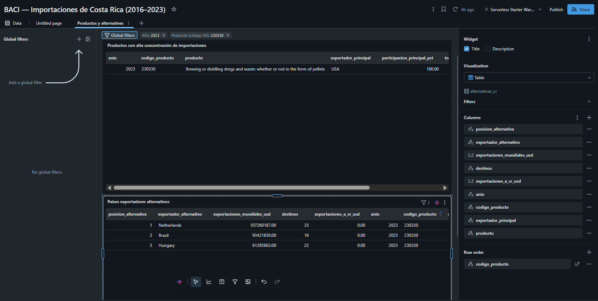

# Dashboard: importaciones de Costa Rica

Guía de uso y recuperación del dashboard **BACI — Importaciones de Costa Rica (2016–2023)**. Utiliza BACI HS92, edición **202501**, y las tablas analíticas construidas por el pipeline de este repositorio.

La publicación se confirmó en Databricks el **19 de noviembre de 2026**. La definición exportada se conserva en la carpeta [dashboards](../dashboards/) como un archivo `.lvdash.json`. Esta guía documenta las consultas, filtros y resultados comprobados durante la configuración.

## Qué permite consultar

La página de resumen anual muestra el valor importado por Costa Rica y la proporción de ese valor correspondiente a los productos seleccionados. La página **Productos y alternativas** permite elegir un año y un código de producto para examinar la concentración de proveedores y los países exportadores alternativos.

Los criterios exploratorios de selección son:

- Importaciones de Costa Rica de al menos **USD 1 millón por producto y año**.
- Participación del proveedor principal de al menos **90 % del valor importado** de ese producto y año.
- Hasta **tres países alternativos**, excluyendo Costa Rica y el proveedor principal.

El ranking de alternativas usa las exportaciones mundiales del mismo producto y año, de mayor a menor. El número de destinos y el código del país resuelven empates. Los montos se presentan en USD nominales.

## Datos que necesita

El dashboard consulta estas tablas persistentes:

| Tabla | Uso |
|---|---|
| `workspace.baci.concentracion_importaciones_cr` | Resumen anual y productos seleccionados. |
| `workspace.baci.alternativas_importaciones_cr` | Ranking de países alternativos. |

Las consultas del dashboard filtran `anio` entre 2016 y 2023, `clasificacion = 'HS92'` y `version_baci = '202501'`. Si se cambia el período, la edición o los criterios del pipeline, también hay que revisar las consultas del dashboard y sus títulos.

Para reconstruir las tablas, seguí la preparación y ejecución descritas en el [README](../README.md). El archivo `.lvdash.json` guarda las consultas y la configuración visual; las tablas de datos deben existir en el workspace donde se importe.

## Datasets del dashboard

| Dataset | Unidad de una fila | Visualización |
|---|---|---|
| `resumen_anual_cr` | Un año. | Importaciones totales y participación del valor seleccionado. |
| `productos_seleccionados_cr` | Un producto y año que cumple los criterios. | Productos con alta concentración de importaciones. |
| `alternativas_cr` | Un país candidato para un producto y año. | Países exportadores alternativos. |

En el resumen anual, `participacion_valor_seleccionado_pct` se calcula como:

```text
100 × importaciones de los productos seleccionados / importaciones totales de CR
```

En 2023 se observaron **USD 22.668.889.443** de importaciones totales, **USD 1.605.237.168** en productos seleccionados y una participación de **7,08 %**. Ese porcentaje mide valor importado, no cantidad de productos ni participación de un país proveedor.

El porcentaje ya está expresado en escala 0–100. En la visualización se muestra como número con dos decimales; aplicar un formato que vuelva a multiplicar por 100 alteraría su presentación.

## Filtros y navegación

Los dos selectores de **Productos y alternativas** son filtros de página. Cada uno está conectado a los dos datasets de detalle:

| Selector | Campo en `productos_seleccionados_cr` | Campo en `alternativas_cr` |
|---|---|---|
| Año | `anio` | `anio` |
| Producto (código HS) | `codigo_producto` | `codigo_producto` |

Se recomienda iniciar con **Año = 2023** y **Producto = All**. Los valores iniciales se configuran en **Default Value** de cada filtro. Los códigos de producto se conservan como texto de seis caracteres, incluidos los ceros iniciales.

Estas son las cantidades de referencia registradas para esta edición y estos criterios:

| Año | Producto | Filas de productos | Filas de alternativas |
|---|---|---:|---:|
| 2023 | `230330` | 1 | 3 |
| 2023 | All | 135 | 405 |
| All | All | 957 | 2.871 |

Una fila arriba y tres abajo es el resultado esperado al seleccionar un producto y año: la primera tabla resume el caso y la segunda muestra sus candidatos. Al elegir **All**, aparecen varios casos. Un producto puede cumplir los criterios en un año y quedar fuera en otro.

Para mantener legibles las alternativas cuando se consultan varios casos, conservá `anio` y `codigo_producto` entre las columnas. Un orden de filas útil es `anio` descendente, `codigo_producto` ascendente y `posicion_alternativa` ascendente.

## Caso verificado: 2023, producto 230330

El producto corresponde a residuos de fabricación de cerveza o destilación. La tabla superior muestra **USA** como proveedor principal y **100,00 %** de participación presentada con dos decimales.

| Posición | País alternativo | Exportaciones mundiales (USD) | Destinos | Exportaciones a CR (USD) |
|---:|---|---:|---:|---:|
| 1 | Netherlands | 107.260.187,00 | 33 | 0,00 |
| 2 | Brazil | 93.421.830,00 | 16 | 0,00 |
| 3 | Hungary | 61.285.663,00 | 22 | 0,00 |



*Captura real del borrador durante la configuración y comprobación de filtros, el 19 de noviembre de 2026. La publicación se confirmó posteriormente.*

`destinos` cuenta países importadores distintos del producto exportado por ese candidato en ese año. Las exportaciones mundiales muestran cuánto exportó el candidato al conjunto de destinos; `exportaciones_a_cr_usd` identifica la parte dirigida a Costa Rica. Un cero señala que no se registró un flujo hacia CR en ese recorte de BACI.

El ranking identifica países con comercio histórico del producto. Puede incluir reexportaciones y requiere análisis adicional de empresas, precios, requisitos de importación y logística para evaluar una operación comercial.

## Recuperar el dashboard

1. Prepará las tablas analíticas mediante el pipeline y completá `04_validaciones`.
2. En la lista de **Dashboards**, elegí **Import dashboard from file**.
3. Seleccioná el archivo `.lvdash.json` de la carpeta `dashboards` y confirmá la importación.
4. Seleccioná un SQL warehouse disponible. Si el catálogo o esquema cambió, ajustá las referencias completas a las tablas en **Data**.
5. Ejecutá los tres datasets y comprobá los filtros con el caso 2023 / `230330`.
6. Publicá con **Publish**. Con **Individual data permissions**, cada lector necesita permisos sobre las tablas consultadas.

El acceso a la versión publicada depende de los permisos de Databricks. Las capturas incluidas en el repositorio permiten revisar un ejemplo sin acceder al workspace.

La importación crea un dashboard. Para recuperar la definición sobre uno existente, usá **File actions → Replace** en su borrador y seleccioná la versión del JSON que querés restaurar.

## Mantener datos, publicación y Git sincronizados

| Cambio | Acción |
|---|---|
| Nuevos datos o reconstrucción del pipeline | Esperar a que terminen las cuatro etapas y usar **Refresh** dentro del dashboard. |
| Consultas, filtros predeterminados, textos o diseño | Revisar el borrador, publicar y exportar la nueva definición. |
| Nueva definición exportada | Reemplazar el JSON correspondiente en `dashboards`, crear un commit y hacer push. |

Para exportar el borrador, abrí el menú **⋮** superior del dashboard y elegí **File actions → Export**. Guardá el archivo descargado en `dashboards`, reemplazando su versión anterior. Desde la raíz del repositorio:

```powershell
git add -- dashboards/
git diff --cached --stat
git commit -m "Update BACI dashboard configuration"
git push
```

El bundle actual administra el Job del pipeline. El dashboard se mantiene mediante exportación e importación del JSON; todavía no está declarado como recurso del bundle.

## Problemas observados y solución

| Síntoma | Comprobación o solución |
|---|---|
| Aparece una sola fila en la tabla superior. | Revisar los filtros: un producto y un año producen un único resumen. Usar Producto = All para ver todos los casos del año. |
| Solo una tabla responde al selector. | Conectar el campo del filtro a ambos datasets de detalle. |
| Un gráfico histórico parece vacío o muestra un solo año. | Revisar la barra de filtros activos; quitar la selección accidental de un año para recuperar la serie. |
| Los nombres de países siguen mostrando texto corrupto después de corregir el pipeline. | Comprobar que la reconstrucción terminó y usar **Refresh** del dashboard para obtener resultados actualizados. |
| Git muestra `dashboards/` como untracked. | Agregar los archivos, comprobar que aparecen preparados con `git status --short`, crear el commit y hacer push. |

La etapa 02 incorpora la reparación estricta de los nombres afectados por una interpretación previa de UTF-8 como Latin-1. La función se comprobó localmente con Côte d'Ivoire, Curaçao, Saint Barthélemy y Türkiye; el nombre Türkiye también se comprobó corregido en el dashboard después de actualizar sus resultados.

Para sumar importaciones de Costa Rica, usá la tabla de concentración. En la tabla de alternativas, el importe del caso se repite por candidato y puede producir doble conteo si se suma directamente.

## Referencias

- [Databricks: exportar, importar o reemplazar un dashboard](https://docs.databricks.com/aws/en/dashboards/automate/import-export).
- [Databricks: filtros conectados a campos de varios datasets](https://docs.databricks.com/aws/en/dashboards/manage/filters/field-filters).
- [Databricks: publicar y compartir dashboards](https://docs.databricks.com/aws/en/dashboards/share/share).
- [Databricks: caché y actualización de resultados](https://docs.databricks.com/aws/en/dashboards/caching).
